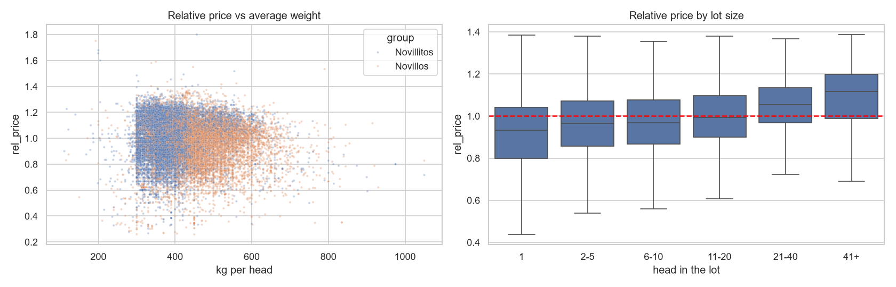
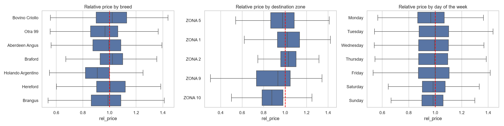
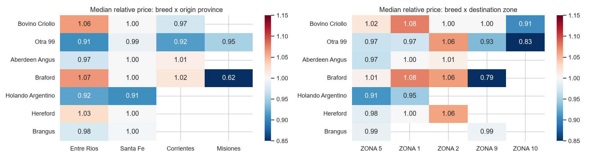
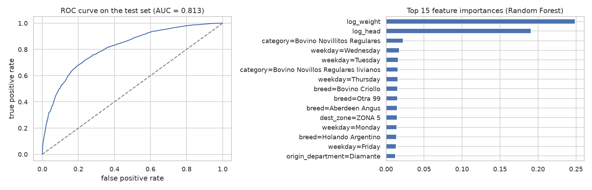

# Cattle Price Prediction — Steers in the Argentine Litoral

This project is a personal initiative born at home: my father trades steers in Entre Ríos, Argentina, and every sale raises the same question — *is this a good price?* It implements an end-to-end Machine Learning project that estimates how much a lot of steers will be paid compared with the market, and which characteristics of the lot move that price.

> **ML Zoomcamp 2026 — Midterm project.** Status: cleaning, EDA, model training and training script done · web service and deployment in progress.

## 📑 Table of Contents
* [❓ Problem Description](#-problem-description)
* [🗃️ Dataset](#️-dataset)
* [🏗️ Project Workflow](#️-project-workflow)
* [🖥️ Technologies Used](#️-technologies-used)
* [🔎 Exploratory Data Analysis](#-exploratory-data-analysis)
* [📖 Data Dictionary](#-data-dictionary)
* [🤖 Models](#-models)
* [🛠️ Reproducibility](#️-reproducibility)
* [📂 Repository Structure](#-repository-structure)
* [🔮 Future Improvements](#-future-improvements)
* [⚠️ Disclaimer](#️-disclaimer)
* [🪐 About the Author](#-about-the-author)

## ❓ Problem Description
In Argentina, cattle are sold to slaughterhouses (*frigoríficos*) in **lots**, at a price agreed per kg of live weight. Two lots of the same category sold in the same week can be paid very differently depending on the breed, the size of the lot, where it comes from, where it is slaughtered and the day it is sold.

A small producer or trader has no simple way to know whether an offer is above or below what the market is paying for similar lots. This project addresses that problem with three questions:

* **Price estimation (regression):** how much will a lot be paid per kg of live weight?
* **Premium detection (classification):** will the lot sell above the typical price of its category that week?
* **Breed analysis:** which breeds are paid above the typical price?

**Scope:** steers and young steers (*novillos* and *novillitos*) from the Litoral provinces **Entre Ríos, Santa Fe, Corrientes and Misiones**.

**How the model is used:** a web service receives the description of a lot (category, breed, origin, destination, number of head, average weight, day of the week) and returns the expected price **relative to the market** and the probability of selling at a premium. Multiplying the relative price by the current market price of the category gives an estimate in today's pesos.

### Why a relative price?
Prices in the dataset are nominal 2018 pesos, a period of high inflation, so predicting pesos directly would mostly learn the calendar. Instead, each lot is compared with the **typical price**: the median price of the same category in the same week across the whole country.

* `rel_price = price_kg / typical_price` → 1.05 means "5% above the market".
* `premium = 1` when `rel_price > 1`.

## 🗃️ Dataset
**SIO Carnes** (*Sistema de Información de Operaciones de Carnes*), published by the Argentine Ministry of Agriculture, Livestock and Fisheries (MAGyP). It records cattle sales **destined for slaughter**, built from electronic sale settlements filed with the tax agency (AFIP) and SENASA transit documents.

| File | Content | Link |
| :--- | :--- | :--- |
| Sales, Jan–Jun 2018 | 544,858 operations, ~71 MB, `;` separated, `latin-1` | [download](https://datos.magyp.gob.ar/dataset/19c2c34b-1f77-4893-afb0-3821d62891fa/resource/e4ff4d34-e5d6-4fc5-aea0-f231f1fd2e43/download/sio-carnes-01-ene-a-30-jun-.csv) |
| Destination zones | Official definition of the 10 slaughter zones | [download](https://datos.magyp.gob.ar/dataset/19c2c34b-1f77-4893-afb0-3821d62891fa/resource/5e6fadc1-522f-4435-9d96-55b7f9cce71b/download/zonas-sio-carnes-.csv) |

Dataset page: https://datos.magyp.gob.ar/dataset/sio-carnes

From the raw file to the modelling dataset:

| Step | Lots |
| :--- | ---: |
| Raw file | 544,858 |
| After cleaning (duplicates, buffalo, impossible head counts and weights) | 409,697 |
| Priced per kg of live weight | 375,861 |
| Steers and young steers, whole country (market reference) | 114,703 |
| **Steers and young steers from the Litoral (project scope)** | **24,466** |

## 🏗️ Project Workflow
The project follows the CRISP-DM process:

1. **Data understanding and cleaning:** every cleaning rule is justified in the notebook (duplicates, impossible values, mapping origins to zones).
2. **Exploratory Data Analysis:** univariate, bivariate and multivariate analysis to choose targets, features and methods.
3. **Modelling:** linear models against tree-based models, with hyperparameter tuning and a time-based validation.
4. **Training script:** `train.py` trains the final models and saves them.
5. **Web service:** `predict.py` serves the models with FastAPI.
6. **Containerization and deployment:** Docker image deployed to the cloud.

## 🖥️ Technologies Used

* Python 3.14
* uv (Package and Project Management)
* pandas, NumPy (Data processing)
* SciPy, statsmodels (Statistical tests)
* Matplotlib, seaborn (Visualization)
* scikit-learn, XGBoost (Models)
* FastAPI, Pydantic, Uvicorn (Web service)
* Docker (Containerization)
* Fly.io (Cloud deployment)

## 🔎 Exploratory Data Analysis
The full analysis is in [notebooks/notebook.ipynb](notebooks/notebook.ipynb). Main findings for the project scope:

* **Lot size is the strongest numeric signal.** Single animals sell about 7% below the typical price; lots of more than 40 head about 12% above.
* **Location matters at department level**, much more than at province level.
* **Destination matters.** Lots sent to Buenos Aires (zones 1 and 2) are paid 2–3% above the typical price; lots slaughtered in their own zone about 2% below.
* **Breed has a small to medium effect.** Braford and Criollo are slightly above the typical price, Angus and Hereford at it, and Holando (a dairy breed) about 9% below. The gaps are larger in Entre Ríos than in Santa Fe.
* **The day of the week has a small effect:** Monday is the weakest day (about 3% below).
* **Weight adds little** once the category is known, because category names already include the weight range.
* Breed, origin and destination **interact**, which favours tree-based models over linear ones.







## 📖 Data Dictionary
Modelling dataset: `data/processed/steers_litoral.csv.gz` (one row per lot, generated by the notebook).

### Features

| Variable | Data Type | Description |
| :--- | :--- | :--- |
| `category` | `VARCHAR` | Official animal category, including quality and weight range (16 levels). |
| `group` | `VARCHAR` | `Novillos` (steers) or `Novillitos` (young steers). |
| `breed` | `VARCHAR` | Breed declared in the sale settlement. |
| `origin_province` | `VARCHAR` | Province the lot comes from. |
| `origin_department` | `VARCHAR` | Department (county) the lot comes from (71 levels). |
| `dest_zone` | `VARCHAR` | Zone of the slaughterhouse (`ZONA 1` to `ZONA 10`). |
| `weekday` | `VARCHAR` | Day of the week of the sale. |
| `head` | `INTEGER` | Number of animals in the lot. |
| `avg_weight` | `FLOAT` | Average live weight per animal, in kg. |

### Targets and reference columns

| Variable | Data Type | Description |
| :--- | :--- | :--- |
| `rel_price` | `FLOAT` | **Regression target.** Price of the lot divided by the typical price. |
| `premium` | `INTEGER` | **Classification target.** 1 if `rel_price > 1`, else 0. |
| `price_kg` | `FLOAT` | Price paid per kg of live weight (ARS, 2018). Not a feature. |
| `typical_price` | `FLOAT` | Median price of the same category and week in the whole country. Not a feature. |
| `date`, `week` | `DATE`, `INTEGER` | Date of the sale and ISO week. Used only to split the data. |
| `split` | `VARCHAR` | `train` (weeks 1–15), `validation` (16–20) or `test` (21–26). |

### Destination zones

| Zone | Area |
| :--- | :--- |
| 1 | Greater Buenos Aires and the City of Buenos Aires |
| 2 | Northern and outer Buenos Aires province |
| 3 | Central Buenos Aires province |
| 4 | Southern Buenos Aires province |
| 5 | Córdoba, Santa Fe, Entre Ríos |
| 6 | San Luis, La Pampa |
| 7 | Patagonia |
| 8 | Cuyo |
| 9 | Northeast (Misiones, Chaco, Formosa, Corrientes) |
| 10 | Northwest |

## 🤖 Models
The data is split **by time** (59% train, 18% validation, 23% test) so the models are evaluated on weeks they have not seen.

| Task | Target | Baseline | Linear model | Tree-based models | Metric |
| :--- | :--- | :--- | :--- | :--- | :--- |
| Regression | `rel_price` | Training median | Ridge regression | Decision tree, Random Forest, XGBoost | RMSE |
| Classification | `premium` | Majority class | Logistic regression | Decision tree, Random Forest, XGBoost | ROC AUC |

Each model is tuned (`C`, `max_depth`, `min_samples_leaf`, `n_estimators`, `eta`, `min_child_weight`) on the validation set, and the best one is evaluated once on the test set.

### Results — premium classification

| Model | Validation AUC |
| :--- | :--- |
| Baseline (majority class) | 0.500 |
| Logistic regression (C=0.1) | 0.715 |
| Decision tree (max_depth=12, min_samples_leaf=20) | 0.743 |
| XGBoost (eta=0.1, max_depth=10, min_child_weight=1) | 0.827 |
| **Random Forest (100 fully grown trees) — selected** | **0.830** |

Random Forest and XGBoost are practically tied; the simpler model was selected. Retrained on train + validation and evaluated once on the test weeks:

| Metric | Test set |
| :--- | :--- |
| ROC AUC | **0.813** |
| Accuracy | 0.746 (baseline 0.556) |
| Precision / Recall | 0.727 / 0.686 |
| ROC AUC on Entre Ríos lots only | **0.834** |

Most important variables: average weight (0.25), origin department (0.21) and lot size (0.19); the breed adds 0.09 — real but secondary, consistent with the EDA.



_The regression task (`rel_price`) follows the same recipe — to do._

## 🛠️ Reproducibility
### Local Setup

#### Prerequisites
* [Python](https://www.python.org/downloads/) 3.14
* [uv](https://docs.astral.sh/uv/): Python package and project manager.

#### Step A: Clone the repository

```bash
git clone https://github.com/your-username/cattle-price-market-prediction.git
cd cattle-price-market-prediction
```

#### Step B: Install the dependencies

```bash
uv sync
```

#### Step C: Download the data
Download the two files listed in [Dataset](#️-dataset) and save them in `data/raw/` without renaming them:

```
data/raw/sio-carnes-01-ene-a-30-jun-.csv
data/raw/zonas-sio-carnes-.csv
```

#### Step D: Run the notebook
It cleans the data, runs the EDA and writes `data/processed/steers_litoral.csv.gz`.

```bash
uv run jupyter notebook notebooks/notebook.ipynb
```

#### Step E: Train the final model
Reproduces the model selected in the notebook (prints the test metrics) and saves it to `models/model.bin`:

```bash
uv run python src/train.py
```

#### Step F: Run the web service and build the Docker image
_To be added with `predict.py` and the `Dockerfile`._

## 📂 Repository Structure

```
cattle-price/
├── README.md
├── pyproject.toml / uv.lock   ← dependencies (uv)
├── data/
│   ├── raw/                   ← original files from MAGyP (not committed)
│   └── processed/             ← cleaned and modelling datasets (generated)
├── notebooks/
│   └── notebook.ipynb         ← cleaning, EDA, model selection
├── src/
│   ├── train.py               ← trains and saves the final model
│   └── predict.py             ← web service (to do)
├── models/                    ← trained models (generated)
├── reports/figures/           ← charts used in this README
├── tests/                     ← tests for the web service
└── deployment/                ← cloud deployment files
```

## 🔮 Future Improvements
The main limitation of this project is the age of the data: the open microdata ends in 2018. The following enhancements are planned:

* **Current market prices:** build a data pipeline that extracts the weekly SIO Carnes reports (published as PDF) to obtain the current typical price of each category, so predictions can be expressed in today's pesos automatically.
* **More years of microdata:** request updated lot-level data from the Ministry to study yearly seasonality, which six months cannot show.
* **Better breed information:** more than half of the lots are recorded as "Criollo" or "Other"; a model could estimate the missing breed group.
* **Dashboard:** an interactive view of prices by category, department and destination for producers.

## ⚠️ Disclaimer
This is an **educational and portfolio project**. Results describe market patterns in historical public data and are **not financial advice**. The analysis measures price premiums, not profit margins: the data has no production costs. Data source: Ministerio de Agricultura, Ganadería y Pesca de la Nación (Argentina), open-data portal. This project is not affiliated with or endorsed by MAGyP.

## 🪐 About the Author
I am a Data Processing and Analytics Engineering student at the Universidad Nacional de Entre Ríos (UNER) in Argentina, with experience in Python, SQL, and data architecture. This project unites my technical skills with a real question from my family's work in the cattle trade.

👩‍💻 Connect with me on LinkedIn: Camila Durand: https://www.linkedin.com/in/camila-ayelen-durand/
